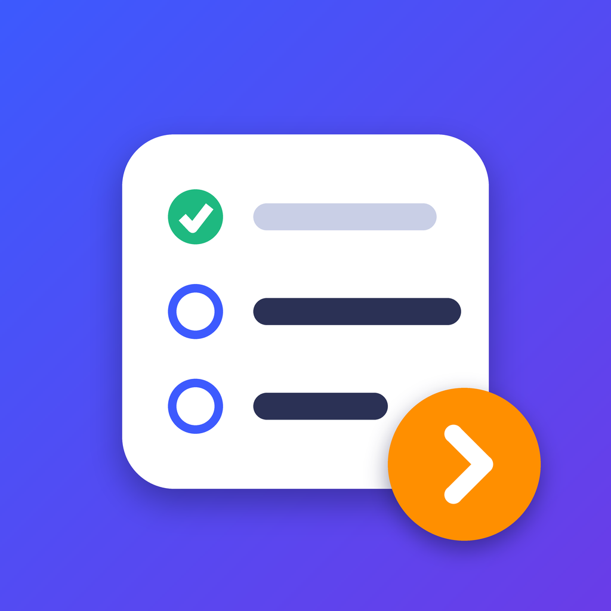

{: width="128"}

**Things to Do Next Planner** is a to-do list, reminder and day planner for iPhone, iPad, Apple
Watch and Android. It shows what matters today, lets you finish it, and helps you plan what's
next. It works fully offline, with no account needed.

- Today, Upcoming, Starred and Completed views, plus your own lists
- Reminders with Complete and Snooze, and repeating tasks (daily, weekdays, weekly, monthly, yearly, custom)
- Day, week and month calendar
- Focus view with your top three tasks
- "Plan my day" turns a rough list into a schedule
- Home-screen widget and Apple Watch app

[Privacy policy](privacy-policy) · [Support](support)
